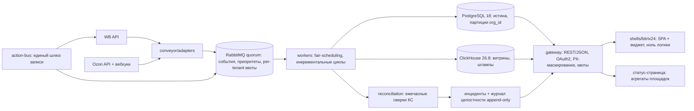
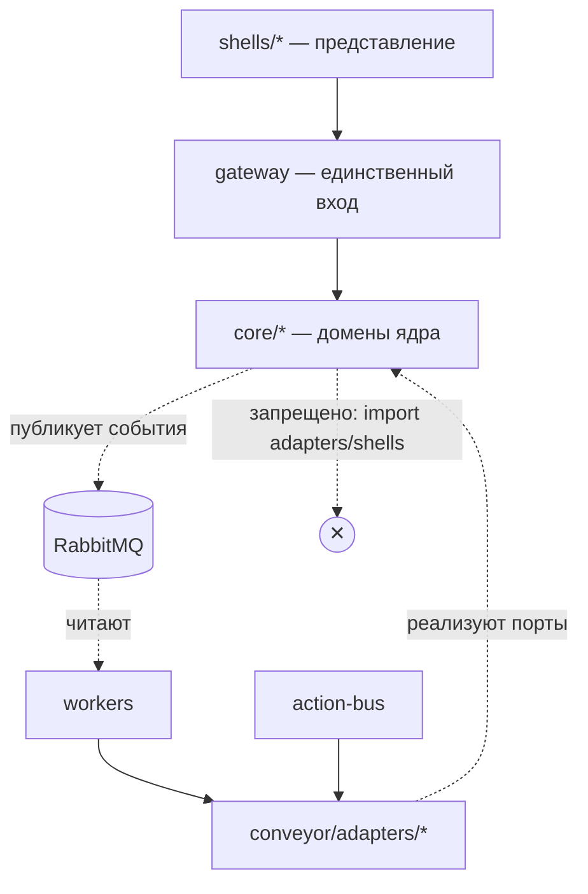

# Architecture Spine — Пульт селлера (MVP Ф0)

## Design Paradigm

**Hexagonal (ports-and-adapters) поверх событийного конвейера.** Домены ядра не знают о площадках и CRM: знание о WB/Ozon/Б24 изолировано в интеграционном слое — адаптеры реализуют порты ядра, домены потребляют «идеальные» внутренние контракты (эталон гл. 9, шесть слоёв). Оболочка заменяема без ядра; новая площадка = новый адаптер, а не изменение домена.

Слои → каталоги:

```text
pult/
  gateway/          # API-шлюз: REST/JSON, OAuth2, квоты, версии контрактов v1
  core/             # домены ядра — платформенно-агностичны, ~80% кода
    sync/           #   синк: приём событий, дедуп, идемпотентность, чекпоинты
    data/           #   витрины, универсальная позиция, штампы «данные на момент»
    finance/        #   финдвижок, налоговый радар, себестоимость
    shturman/       #   аномалии + брифинг (Ф0: правила, без LLM)
    rules/          #   событие → условие → действие
    billing/        #   тарифы, квоты, заглушки «+ИИ-роль»
    identity/       #   организации, роли, «Пульт ID» (каркас)
  conveyor/         # интеграционный конвейер: 6 стадий
    adapters/       #   wildberries/ (полная глубина), ozon/ (чтение + вебхуки)
    action_bus/     #   единый шлюз записи: политики, журнал, идемпотентность
    reconciliation/ #   ежечасные сверки контрольных сумм, журнал целостности
    workers/        #   fair-scheduling воркеры, инкрементальные циклы
  shells/
    bitrix24/       # приложение Б24: встройки, виджет, SPA — ноль бизнес-логики
  platform/         # очередь, кэш, rate-limit, observability-обвязка
  db/               # миграции (sqlx migrate), схемы, партиционирование
  deploy/           # IaC, docker, окружения dev/stage/prod
```

Правило зависимостей (само по себе инвариант, см. AD-1): `shells → gateway → core`; `conveyor/adapters → порты core`; **core никогда не импортирует** `adapters` и `shells`.

## Invariants & Rules

### AD-1 — Гексагональная граница ядра

- **Binds:** все FR; `all`
- **Prevents:** расползание знания о площадках по доменам; ядровая логика, переписываемая при подключении новой площадки/CRM.
- **Rule:** домены `core/*` обращаются к внешним системам только через порты (интерфейсы ядра); имплементации живут в `conveyor/adapters/*` и `shells/*`. Импорт `adapters`/`shells` из `core` запрещён (lint-правило CI). Ноль бизнес-логики в оболочках; доля ядра в самой бедной оболочке ≥ 90%. [ADOPTED — эталон гл. 9]

### AD-2 — Блокинг матчинга (контракт A-1)

- **Binds:** FR-4, FR-21
- **Prevents:** вычислительный взрыв вероятностного матчинга на каталогах 10К+ SKU; невыполнимость бенчмарка 15–25 чел.-часов.
- **Rule:** кандидаты маппинга предфильтруются по (категория, бренд, нормализованный артикул) ДО вероятностного сравнения; блокинг — контракт конвейера, не опциональная оптимизация. [ADOPTED]

### AD-3 — Инкрементальность циклов (A-2)

- **Binds:** FR-3, FR-8, FR-9, FR-25
- **Prevents:** тяжёлый портал (первичный синк 10К+ SKU) блокирует циклы лёгких; полные перезагрузки как норма.
- **Rule:** синк, сверки и витрины работают дельтами с чекпоинтами по `(organization_id, тип цикла)`; полный пересбор — только по явной команде с журналом. [ADOPTED]

### AD-4 — Партиционирование по organization_id (A-3)

- **Binds:** FR-9, FR-29, NFR изоляции (PRD §10)
- **Prevents:** соседство PII разных организаций в одной физической единице; шумоизоляция нагрузки.
- **Rule:** витрины и очередь событий физически партиционированы по `organization_id` в PostgreSQL (и по соответствующему ключу в ClickHouse-витринах); изоляция нагрузки и PII — одно решение. [ADOPTED]

### AD-5 — Per-tenant квоты (A-4)

- **Binds:** FR-34, FR-8, тарифы §12 PRD
- **Prevents:** мега-клиент съедает слоты очередей/API всех; маржинальность падает ниже 75%.
- **Rule:** квоты на организацию (заказы/мес, SKU, кабинеты, вызовы API адаптеров) enforced биллинг-контуром на шлюзе и планировщиком воркеров; счётчик-истина квот — в PostgreSQL. SLA-инвариант «ноль тихих потерь» главнее квот: приём заказов, инциденты и сверки квотой не ограничиваются — сверхквота даёт предупреждение, ограничивает аналитические витрины и автодействия (не приём данных) и предлагает пакет. [ADOPTED; ужесточено ревью: квоты не могут создать тихую потерю]

### AD-6 — Fair-scheduling воркеров (A-5)

- **Binds:** FR-3, FR-8, AD-5
- **Prevents:** SLA лёгких порталов страдает от тяжёлых; хаммер-эффект (камень №31).
- **Rule:** планировщик очередей даёт каждой организации гарантированную долю слотов воркеров + приоритеты внутри (сначала заказы); стресс-инвариант — 10К–100К SKU без деградации чужих порталов; стресс-тест — демо-кабинет №2 (Ф2). [ADOPTED]

### AD-7 — Action-bus — единый шлюз записи (A-6)

- **Binds:** FR-12, FR-18, FR-28; все будущие write-пути (M5 цены, M9 ответы, ИИ-роли)
- **Prevents:** расползание write-путей мимо журнала и лимитов; ретрофит ×3–5 в Ф2.
- **Rule:** любая операция записи наружу (статусы отгрузок WB FBS/realFBS; далее — цены, ответы, автодействия) идёт только через `conveyor/action_bus` с политиками «кто / что / в каких лимитах / с каким журналом», идемпотентными ключами и журналом обратных вызовов. Роботы и ИИ-роли — только через него. [ADOPTED]

### AD-8 — Data-flywheel с первого пилота (A-7)

- **Binds:** FR-30, SM-3; каркас гейтов доверия
- **Prevents:** журнал «контекст → рекомендация → действие → исход» невозможно восстановить задним числом.
- **Rule:** каждая рекомендация/автодействие пишется в журнал flywheel с первого пилота, до появления ИИ-ролей (в Ф0 — события правил и аномалий). [ADOPTED]

### AD-9 — Сетка автономии L0–L4 как атрибут функций (A-8)

- **Binds:** FR-31..FR-33, все будущие ИИ-функции
- **Prevents:** «тихое» повышение автономии без гейтов доверия; обещание L4.
- **Rule:** уровень автономии — явный атрибут каждой функции в ТЗ/сторис; в Ф0 все функции ≤ L1; повышение — только через гейты (≥ 70% принятых 2 цикла, ноль «галлюцинаций в действии», ≥ 100 положительных исходов flywheel); L4 не выпускается. [ADOPTED]

### AD-10 — Explainability и пакетный откат (A-9)

- **Binds:** FR-31, FR-18; все будущие автодействия
- **Prevents:** чёрный ящик автодействий; неотменяемые ошибки ИИ-ролей.
- **Rule:** каждое автодействие несёт топ-3 фактора объяснения; действия роли откатываются пачкой; kill-switch роли срабатывает при первом денежном инциденте с автоматическим понижением уровня. [ADOPTED]

### AD-11 — Тарифная заглушка «+ИИ-роль» (A-10)

- **Binds:** FR-35, биллинг-модель
- **Prevents:** перекройка тарифной сетки при активации ИИ-ролей в Ф2.
- **Rule:** слоты ИИ-ролей (идентификаторы, цены-заглушки 990–2 990 ₽) присутствуют в биллинг-модели и витрине тарифов с Ф0; активация Ф2 не меняет структуру сетки. [ADOPTED]

### AD-12 — Правовой контур автономии (A-11)

- **Binds:** оферта, AD-9, AD-10
- **Prevents:** юридическая незащищённость автодействий; нарушение KZ-запрета решений исключительно на автоматизированной обработке.
- **Rule:** лимиты ответственности ИИ-ролей (стоп-суммы) — в оферте; журнал + откат = доказательная база; эскалация человеку обязательна на L3; дисклеймер «операционная работа, не консультация». [ADOPTED]

### AD-13 — Единственный вход: API-шлюз с версионированными контрактами

- **Binds:** FR-2, FR-5..FR-7, все оболочки; public API (Ф2)
- **Prevents:** обход квот/PII-маскирования мимо шлюза; ломающие изменения API для оболочек.
- **Rule:** оболочки, партнёры и future public API входят только через `gateway` (REST/JSON, OAuth2, partner-keys, квоты); новый контракт = новая версия (`/v1`, `/v2`), старая не молча меняется. PII-маскирование по ролям — на шлюзе. [ADOPTED]

### AD-14 — Владение данными: PG = истина, ClickHouse = производные витрины, очередь = журнал конвейера, Valkey = эфемерное

- **Binds:** FR-9, FR-10, FR-22..FR-27, AD-3, AD-4
- **Prevents:** две копии истины; «витрина главнее источника»; потеря событий между стадиями.
- **Rule:** PostgreSQL 18 — system of record операционных сущностей (партиции AD-4); ClickHouse 26.8 — производные аналитические витрины, пересобираемые; RabbitMQ (quorum) — журнал событий конвейера (at-least-once + дедуп в `core/sync`); Valkey — только кэш/локи/rate-limit/pub-sub, не источник истины (кэш-слой Valkey — мандат AD-28; в ранних редакциях spine фигурировал как «Redis»). Журнал целостности — append-only в PG, экспонируется пользователю. Канбан (FR-16, лаг ≤ 15 мин) читает из PG; CH — только аналитика. Штамп витрины = `{organization_id, источник, fetched_at, built_at, reconciliation_cycle_id}`; лаг = now − fetched_at; штамп генерируется единым кодом ядра (reconciliation/воркеры), не оболочкой. [дополнено ревью]

### AD-15 — Идемпотентность и доставка с дедупликацией

- **Binds:** FR-8, FR-12, вебхуки Ozon, роботы
- **Prevents:** дубли заказов/статусов при ретраях; «двойная отгрузка» при повторе вебхука.
- **Rule:** все внешние write-пути (action-bus) и приём вебхуков несут идемпотентный ключ; домен `sync` дедуплицирует по `(organization_id, площадь, внешний id)`; доставка at-least-once — норма, потребитель обязан быть идемпотентным. Для поллинга без внешнего события (WB) ключ = стабильный `hash(площадка, тип сущности, внешний id, revision)`; для вебхуков — внешний event id поставщика. [дополнено ревью]

### AD-16 — Token-vault и PII-периметр ядра

- **Binds:** FR-2, FR-29, NFR безопасность (PRD §10), 152-ФЗ/420-ФЗ
- **Prevents:** утечка токенов/PII; оборотные штрафы; доступ к PII мимо журнала.
- **Rule:** токены площадок — AES-256-GCM (KMS-конверт) в выделенном хранилище; читает только интеграционный слой, минимальные скоупы, ротация без расшифровки в логах, пауза вместо полурабочего состояния. PII покупателей (FBS-контакты) хранится в ядре, маскируется на шлюзе для всех ролей, кроме Владелец/Логист; каждое обращение к PII журналируется; аналитика/ML — только обезличенные агрегаты. РФ-хостинг, гео-распределение; передача третьим лицам отсутствует по архитектуре. PII-манифест (перечень PII-колонок — единственный источник правды) + CI-тест, запрещающий PII-колонки в схемах ClickHouse-витрин, обучающих выборках и экспортах — бэкапы CH без PII по построению. [ADOPTED; ужесточено ревью]

### AD-17 — Операционный конверт: РФ-гео, RPO 15 мин, RTO 4 ч

- **Binds:** NFR (PRD §10), SLA-обещание, 152-ФЗ
- **Prevents:** невыполнение SLA 99,5%/мес; потеря данных при аварии; выход за юрисдикцию.
- **Rule:** вся инфраструктура — РФ-хостинг минимум в двух зонах доступности; PG — WAL-архивация + PITR (RPO ≤ 15 мин), ежедневные снапшоты ClickHouse-витрин; RTO ≤ 4 ч — runbook + квартальные репетиции; провайдер заменяем через IaC (деплой описан декларативно, `deploy/`); контуры СНГ — только после Ф4, красная линия из PRD §11.

### AD-18 — Наблюдаемость и публичность целостности

- **Binds:** FR-9, FR-10, FR-30, статус-страница; ИРП-пороги эталона
- **Prevents:** невидимые расхождения; паника вместо доверия при сбоях; тихие деградации.
- **Rule:** метрики стадий конвейера (лаги, ошибки, глубина очередей, сверки) экспортируются в Prometheus; синтетические пробы контрактов площадок каждые 15 мин (обезличенные агрегаты); алерты по порогам эталона (жёлтые сверки > 0,5%/сутки; 401/403 у > 2 порталов/час; глубина очереди > 15 мин и др.); сквозной `request_id` обязателен; статус-страница обновляется автоматически; журнал целостности доступен селлеру вечно (append-only).

### AD-19 — Релизный конвейер адаптеров: контрактные тесты + канарейка 5%

- **Binds:** FR-8, AD-7, «48 часов адаптации»
- **Prevents:** «молчаливые» потери полей при изменениях API площадок (риск №1); регресс адаптера на всех порталах.
- **Rule:** релиз адаптера: обнаружение (проба/сверка) → дифф контракта → ветка → контрактные тесты на синтетике → канарейка 5% порталов → полный раскат; сверки продолжаются независимо от релизов; ежечасная сверка контрольных сумм — страховочная сеть конвейера.

### AD-20 — Один язык ядра: Rust; тонкие оболочки

- **Binds:** AD-1; команда 5 чел.; «ядро не вайбкодится»; приоритеты владельца (28.10.2026): молниеносный отклик, минимальная стоимость серверных ресурсов, масштабируемость до 1000+ одновременных пользователей (AD-29)
- **Prevents:** зоопарк языков для команды из 5 человек; утолщение оболочек; непредсказуемые паузы GC на p99; перерасход RAM/vCPU на тот же профиль нагрузки.
- **Rule:** бэкенд — один язык: **Rust (stable, async-рантайм Tokio)**: Axum — REST-шлюз, SQLx — PostgreSQL (compile-time проверенные запросы), Tokio — воркеры конвейера. Обоснование: нагрузка продукта — I/O-heavy интеграционный хаб (поллинг/вебхуки площадок, JSON-трансформации, конвейер) — Rust держит предсказуемый p99 без GC-пауз и даёт ~5–10× меньший footprint RAM против Python-стека (малая VM вместо «толстой» — прямая экономия ФОТ серверов, см. AD-29); единый статический бинарник упрощает деплой в РФ-контуре. Зафиксированный компромисс: скорость разработки ниже Python — компенсируется AI-агентной разработкой (BMAD) и обязательным ревью ядра; найм — со средним+ порогом. ML-контур (градиентный бустинг, CPU-инференс, Ф1+) — отдельный Python-сервис за шлюзом, вне ядра (периметр AD-21). Оболочка Б24 — TypeScript/React SPA в iframe, только представление и платформенные API-клиенты. Код ядра и интеграций проходит обязательное ревью. [пересмотр 28.10.2026: Python 3.14/FastAPI → Rust по требованию владельца; детали — в .memlog.md]

### AD-21 — LLM-периметр (каркас Ф0, активация Ф1)

- **Binds:** FR-31..33 (Ф0 — без LLM); бюджет инференса 7%
- **Prevents:** LLM-вызовы напрямую из доменов; перерасход инференса; невыполнение KZ-требований human-in-the-loop.
- **Rule:** в Ф0 — ноль LLM-вызовов в продуктовых путях (аномалии/брифинг — правила и статистика). С Ф1 весь LLM-трафик идёт через LLM-шлюз: российские провайдеры (GigaChat/YandexGPT) + self-hosted фолбэк для массовых задач; бюджет инференса ≤ 7% выручки enforced шлюзом; RAG-индексы физически изолированы по порталам. [ADOPTED]

### AD-22 — Канонические внутренние контракты и событийный конверт

- **Binds:** AD-1; все адаптеры, воркеры, домены; FR-16 (статусный словарь канбана)
- **Prevents:** несовместимые события/сущности от разных адаптеров и продюсеров; расползание нормализации статусов.
- **Rule:** внутренние схемы сущностей и событий версионируются в core-портах (`core/*/ports.rs` + schema-registry, `schema_version`); событие — JSON-конверт `{event_id: UUIDv7, event_type: past-tense, organization_id, occurred_at, schema_version, payload}`; консьюмеры обязаны толерантно пропускать неизвестные поля; нормализация статусов площадок в единый статусный словарь канбана — домен `core/sync`, сырые ответы сохраняются в `platform_payload`.

### AD-23 — Единая модель рабочих элементов («задача» и «инцидент»)

- **Binds:** FR-14, FR-17, FR-28, FR-30; создатели: конвейер/сверки, таймеры M2, финмодель, аномалии M10, онбординг
- **Prevents:** два владельца очередей задач/инцидентов; разные enum приоритетов; дубли «задача + инцидент» об одном событии; нативные задачи Б24 как второй владелец.
- **Rule:** «задача» и «инцидент» — сущности одного домена `core/rules` с единым enum приоритетов и дедупликацией (один триггер → один рабочий элемент); все создатели действуют через единый порт рабочих элементов; очередь «что сделать сегодня» (FR-14) и журнал (FR-30) — проекции; нативные задачи Б24 — только экспорт-зеркало, не источник истины.

### AD-24 — Бизнес-время портала

- **Binds:** FR-15 («вчера»), FR-17 (таймеры), FR-32 (брифинг 8:00), планировщик циклов
- **Prevents:** три системы считают «вчера»/дедлайны/брифинг по разным часам.
- **Rule:** IANA-таймзона портала хранится в `core/identity` (дефолт Europe/Moscow); границы локального дня (витрины «вчера», время брифинга) — по локальному дню портала; SLA-таймеры, штампы, `occurred_at` — UTC (`timestamptz`); переводы часов — только IANA-данными, не ручными смещениями.

### AD-25 — Маржа: единственный владелец расчёта

- **Binds:** FR-22..FR-27; CH-витрины; AD-14
- **Prevents:** два легальных расчёта маржи (финдвижок в PG и CH-SQL) с разными округлениями.
- **Rule:** расчёт полной стоимости, маржи и налогового радара выполняет только `core/finance` (результат — в PG); ClickHouse-витрины хранят и агрегируют результаты, но не вычисляют заново; округление — ROUND_HALF_UP до копеек (integer minor units — конвенция); штампы фин-витрин — от цикла финдвижка.

### AD-26 — SLA-компенсация как каркас

- **Binds:** FR-11, FR-9; вопрос 8.2 PRD; биллинг-мост пула Б24
- **Prevents:** ручные «зачтём месяц» от поддержки; потерянные entitlements; расхождение с пулом Б24.
- **Rule:** SLA-кейс (расхождение не восстановлено за 4 часа с момента обнаружения) автоматически создаёт `compensation_entitlement` (месяц подписки) в `core/billing` по таймеру от создания инцидента-расхождения, с верификацией восстановления сверкой; исполнение — биллинг-мостом (Ф0: журнал entitlement + отражение «месяц без начисления усилий» в отчётности пула Б24; Ф2+: кредит-нота биллинг-хаба); без участия поддержки руками.

### AD-27 — Демо-кабинет изолирован

- **Binds:** FR-6; изоляция тенантов; демо-кабинеты №1/№2
- **Prevents:** демо-данные в прод-очередях и витринах; «демо = ещё один портал» с прод-приоритетом; начисление пула за демо.
- **Rule:** демо-порталы — отдельный контур (флаг `demo`, отдельные схемы/партиции, синтетические данные без реальных PII); в прод-приоритетах очередей демо не участвует (наинизший приоритет или собственные воркеры); пула подписки Б24 демо не начисляется.

### AD-28 — Кэш-слой: Valkey, НЕ Redis (мандат для всех агентов разработки)

- **Binds:** AD-14 (Valkey = эфемерное), AD-5 (кэш счётчиков квот), AD-18 (алерты), AD-22 (rate-limit-менеджер); все эпики/сторис, docker-compose, IaC
- **Prevents:** подмена стека агентом-разработчиком (туториалы и дефолты ставят Redis); расхождение документации и кода; лицензионные риски Redis™ (RSALv2/SSPLv1); невозможность использовать managed-сервис YC (managed Redis в Yandex Cloud не существует — только Managed Valkey).
- **Rule:** ВСЕ эфемерные состояния — кэш, распределённые локи, rate-limit, pub/sub fanout, сессии — работают на **Valkey** (форк Redis 7.4 под опекой Linux Foundation, лицензия BSD-3-Clause, протокол RESP-совместим). ЗАПРЕЩЕНО: сервер Redis™ в коде, конфигах, IaC, docker-compose (CI-grep: docker-образ `redis:` и managed-ресурс класса `redis` — ошибка сборки; допустимы только клиентские библиотеки, говорящие на RESP). Клиент в Rust: `redis-rs` (де-факто стандарт, RESP2/RESP3, полноценно работает с Valkey) или официальный `valkey-glide` — выбор при init `platform/`; **имя клиентской библиотеки ≠ выбор сервера: сервер — всегда Valkey**. Self-host Ф0: образ `valkey/valkey` 9.1.x; managed YC: Managed Valkey (линии 7.2/8.0/8.1/9.0-valkey). Истина квот/счётчиков — всегда в PostgreSQL (AD-5, AD-14); Valkey — только эфемерно и восстановимо.

### AD-29 — Модель ёмкости и масштабируемости (профиль: 1000 одновременных активных пользователей)

- **Binds:** AD-5, AD-6, AD-13, AD-17, AD-18; деплой-топология Structural Seed
- **Prevents:** деградация/зависание при росте порталов; масштабирование «вертикальным апгрейдом» без пути горизонтали; сюрпризы на первой тысяче пользователей.
- **Rule:** **горизонт без состояния**: `gateway` и `workers` — stateless (сессии/локи — Valkey, события — RabbitMQ, истина — PG), реплики за балансировщиком (nginx/YC ALB) без sticky-sessions; WS-соединения балансируются по узлам шлюза, fanout дельт — Valkey pub/sub. **Целевая ёмкость Ф0** (исходная оценка, подлежит нагрузочной валидации): 1000 одновременных активных пользователей ≈ 100–300 RPS API + 2000–5000 WS-соединений → 2 узла gateway (2 vCPU/4 ГБ) с запасом ≥ 5× (Rust-узел держит порядки 10³–10⁴ RPS на JSON-API); воркеры масштабируются autoscale по глубине очередей RabbitMQ (fair-scheduling AD-6 защищает tenants от тяжёлых соседей). **Первая точка насыщения — PostgreSQL**: предохранители — PgBouncer (пул к primary ≤ ~100 соединений), чтение аналитических витрин — с реплики, кэш горячих чтений — Valkey, партиционирование по organization_id (AD-4); топология primary + реплика с PITR (AD-17). **Деградация управляемая** (backpressure: rate-limit-менеджер AD-22, квоты AD-5, лимиты очередей, приоритеты): «медленнее, но достоверно», никогда «тихая потеря» (SLA-инвариант). Статика SPA — CDN (brotli, HTTP/2). Перед продом — обязательный нагрузочный тест профилем «1000 пользователей» (k6), метрики ёмкости — в наблюдаемость (AD-18).

### AD-30 — Бюджет производительности фронтенда (запрет фризов)

- **Binds:** FR-13..FR-18 (панель, канбан), оболочка Б24; UX (Sally)
- **Prevents:** ощущение тормозов: тяжёлый бандл, полные перезагрузки витрин, лаг канбана, «белый экран» в iframe Б24, polling-штормы.
- **Rule:** SPA React 19 + Vite 8, TypeScript. Обязательные практики: код-сплиттинг по маршрутам модулей (ленивые чанки); критический путь бандла < 200 КБ gzip (виджет Б24 < 150 КБ gzip); данные — TanStack Query (кэш, дедуп запросов, prefetch популярных витрин, **оптимистичные мутации** канбана/задач); канбан — виртуализация списков (TanStack Virtual); дельта-обновления по WebSocket (конверт AD-22), никакого клиентского polling-шторма; скелетоны вместо спиннеров; ассеты — immutable-кэш + brotli + CDN (AD-29). **Бюджеты Core Web Vitals: LCP < 2 с (4G), INP < 200 мс, CLS < 0.1** — CI-гейт (bundle-size + Lighthouse): превышение бюджета блокирует merge.

## Consistency Conventions

| Concern | Convention |
| --- | --- |
| Naming | Таблицы/поля — snake_case; события — past-tense точечные (`order.created`, `stock.discrepancy.detected`); домены = пакеты `core/*`; порты = `core/*/ports.rs` (Rust-trait), имплементации — `conveyor/adapters/*` |
| Data & formats | Деньги — integer копейки (RUB minor units), никогда float; ID — UUIDv7; время — `timestamptz` UTC, в API — ISO-8601 с зоной; ошибки — конверт `{error: {code, message, request_id, details}}`; витрины несут штамп «данные на момент» |
| State & cross-cutting | Мутации наружу — только через action-bus (AD-7); витрины CH — производные, пересобираемые; PG — единственная истина (AD-14); структурированные логи со сквозным `request_id` (AD-18); волатильные факты (пороги налогов, тарифы площадок, правила пула) — конфигурационные таблицы/справочники, не код; миграции — forward-only, additive-first (expand-contract), через sqlx migrate |

## Stack

*Проверено вебом 27.10.2026; пересмотрено 28.10.2026 (AD-20 Rust, AD-28 Valkey — Директива актуальности); код владеет версиями с первого коммита.*

| Name | Version |
| --- | --- |
| Rust (бэкенд-язык ядра; AD-20) | stable 1.99.x (1.99.1, проверено 28.10.2026); toolchain — фиксируется `rust-toolchain.toml` |
| Axum / Tokio (REST-шлюз; async-рантайм, воркеры) | 0.8.x (0.8.9) / 1.54.x (1.54.1, crates.io 21.10.2026) |
| SQLx (PG-драйвер, compile-time SQL, миграции) | 0.9.x (0.9.0; миграции — `sqlx migrate`, forward-only) |
| PostgreSQL (system of record) | 18.x (18.6, патч 13.08.2026; PG 19 — RC, не берём) |
| ClickHouse (аналитические витрины) | 26.8 LTS (патч линии — свежий при init; поддержка до 08.2027) |
| RabbitMQ (очередь событий, quorum queues) | 4.4.0 |
| **Valkey** (кэш, локи, rate-limiter, pub/sub) — **НЕ Redis™** (мандат AD-28) | 9.1.x (9.1.3, self-host `valkey/valkey`); managed YC — линия 9.0-valkey |
| React / Vite (SPA оболочки Б24, TypeScript) | 19.x (19.3.1) / 8.x (8.3.5) |
| Prometheus + Grafana + Alertmanager (наблюдаемость) | актуальные self-hosted релизы на дату провижининга |

## Structural Seed

**Поток данных конвейера (6 стадий, Ф0):**



**Правило зависимостей (hexagonal):**



**Развёртывание (РФ, ≥2 зоны доступности):**

```text
deploy/
  envs/dev|stage|prod     # dev: 1 зона, локальные контейнеры; prod: 2 зоны
  prod: [api-шлюз ×2, workers ×N, RabbitMQ кластер ×3, PG primary+replica (PITR),
         ClickHouse ×2 (репликация), Valkey ×3 (sentinel / managed YC), status-page static]
  IaC: OpenTofu/Terraform [ASSUMPTION: инструмент — при провижининге]
```

## Capability → Architecture Map

| Capability / Area (PRD §4) | Lives in | Governed by |
| --- | --- | --- |
| Онбординг и демо (FR-1..FR-7) | `gateway` + `shells/bitrix24` + `core/identity` | AD-1, AD-13, AD-16, AD-27 |
| Конвейер и целостность (FR-8..FR-12) | `conveyor/adapters`, `workers`, `reconciliation`, `action_bus` | AD-3, AD-6, AD-14, AD-15, AD-19, AD-22 |
| M1 Панель (FR-13..FR-15) | `core/data` + витрины CH + `shells/bitrix24` | AD-14, AD-18 |
| M2 Заказы (FR-16..FR-18) | `core/sync`, `core/data`, `action_bus` | AD-7, AD-15, AD-19 |
| M3 Остатки/маппинг (FR-19..FR-21) | `core/data` (матчинг) + `workers` | AD-2, AD-3 |
| M4 Финансы (FR-22..FR-27) | `core/finance` + витрины CH | AD-14; волатильные пороги — конфиг-таблицы |
| M8-лайт Задачи/роли (FR-28..FR-30) | `core/rules`, `core/identity` | AD-23, AD-24, AD-13 (PII-маскирование), AD-18 |
| M10/M11-лайт Аномалии/брифинг (FR-31..FR-33) | `core/shturman` + `core/data` | AD-21, AD-8 |
| Тарифы/квоты (FR-34..FR-35) | `core/billing` + `gateway` (enforce) | AD-5, AD-11 |
| SLA-компенсация (FR-11) | `conveyor/reconciliation` + `core/billing` | AD-14, AD-26; журнал — доказательная база |
| Каркасы автономии (A-6..A-11) | `action_bus`, `core/data` (flywheel), ТЗ-атрибуты | AD-7..AD-12, AD-21 |

## Deferred

- Детальная модель данных (сущности, поля, ERD-атрибуты) — эпики/сторис и `db/`; spine фиксирует только ownership (AD-14) и партиционирование (AD-4).
- Спецификация API-контрактов v1 (OpenAPI-схемы шлюза) — при инициализации `gateway/`; формат идемпотентных ключей и точные лимиты квот API — там же.
- Провайдер РФ-хостинга и конфигурация гео-распределения — при провижининге (кандидат Yandex Cloud: managed PostgreSQL 18 подтверждён каталогом; managed ClickHouse в каталоге — только до 26.5 / LTS 25.8 и 26.3 → для линии 26.8 LTS в Ф0 — self-host в docker-compose на VM, миграция на managed при появлении; кэш-слой — Valkey, Redis™ исключён (мандат AD-28): self-host `valkey/valkey` или Managed Valkey YC (линии 7.2–9.0-valkey); критерии: 152-ФЗ-локализация, ≥ 2 зоны доступности).
- Оркестрация контейнеров: Ф0 — docker-compose на managed-VM + systemd; Kubernetes переоценить на Ф1 при > 30 порталов.
- Инструмент IaC (OpenTofu vs Terraform) и конвейер CI/CD (GitHub Actions — базовый; git-хостинг кода — у владельца) — при провижининге.
- Точные миноры React/Vite, UI-библиотека оболочки Б24 — при init `shells/bitrix24` (UX — Sally). [уточнено ревью: React 19.3.1 / Vite 8.3.5]
- LLM-шлюз (провайдеры, фолбэк-модель, кэш 60–80%, RAG) — Ф1 (AD-21 фиксирует периметр).
- Платёжные адаптеры ×2 с failover < 24 ч (биллинг-хаб) — Ф2.
- Билд-каналы витрин Б24 под модерацию (камень №20) — Ф1.
- Репликация ClickHouse и стратегия пересборки витрин при смене схем — эпик данных Ф0, детали в `db/`.

